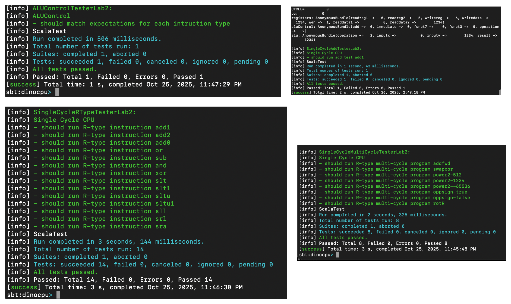
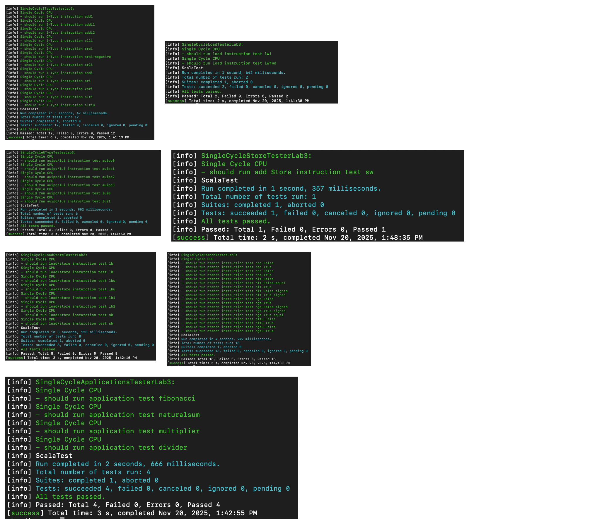
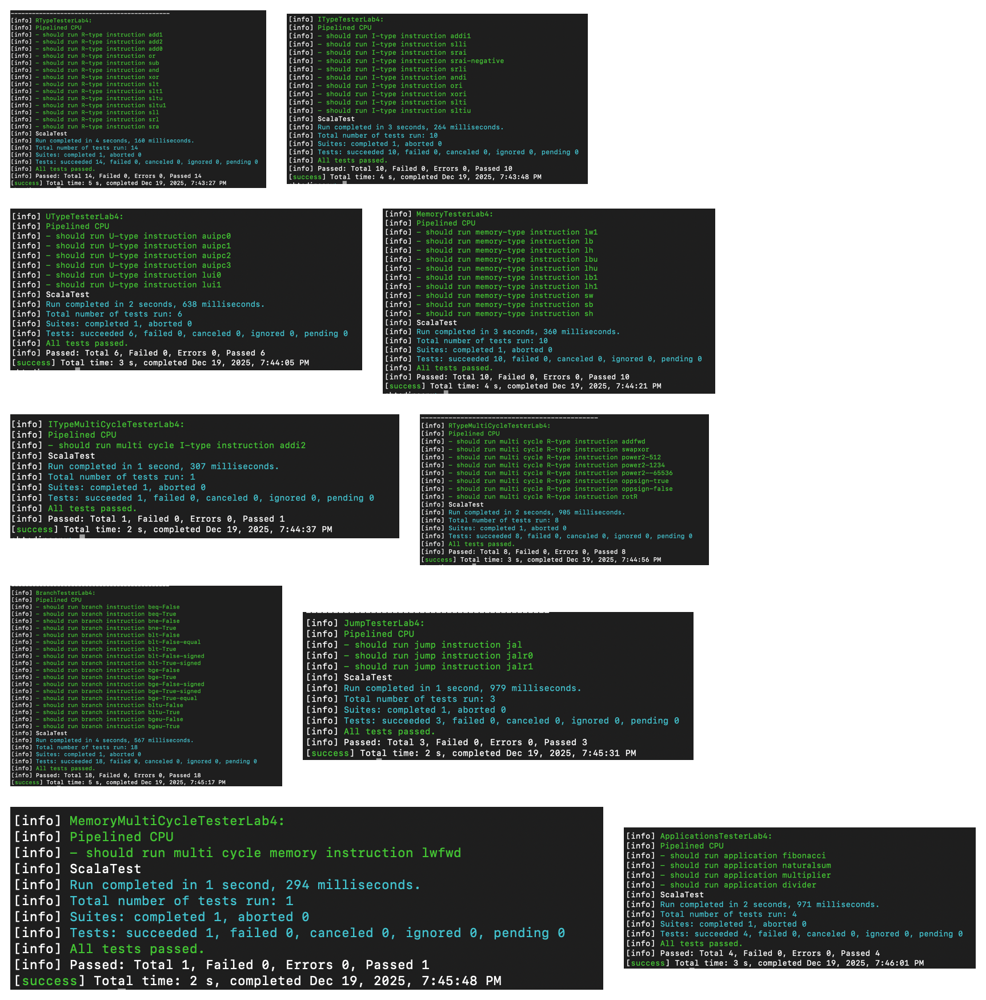

# Verification history

These images were extracted from the original Lab 2, Lab 3, and Lab 4 reports.
They document the staged progression from ALU control and R-type execution to
a complete single-cycle CPU and then to the five-stage pipelined CPU.

The counts are reported per milestone. Later labs repeat many earlier
instruction cases, so the totals should not be interpreted as 150 unique
requirements.

## Lab 2 - 24/24 passed

| Suite | Passed |
| --- | ---: |
| ALU control | 1 |
| Single add instruction | 1 |
| R-type instructions | 14 |
| Multi-instruction R-type programs | 8 |
| **Total** | **24** |

## Lab 3 - 51/51 passed

| Suite | Passed |
| --- | ---: |
| I-type instructions | 12 |
| Load tests | 2 |
| U-type instructions | 6 |
| Store test | 1 |
| Combined load/store instructions | 8 |
| Signed and unsigned branches | 18 |
| Applications: Fibonacci, natural sum, multiplier, divider | 4 |
| **Total** | **51** |

## Lab 4 - 75/75 passed

| Suite | Passed |
| --- | ---: |
| R-type instructions | 14 |
| I-type instructions | 10 |
| U-type instructions | 6 |
| Loads and stores | 10 |
| Branches | 18 |
| Jumps | 3 |
| Multi-instruction dependency tests | 10 |
| Applications: Fibonacci, natural sum, multiplier, divider | 4 |
| **Total** | **75** |

The Lab 4 tester source itself was not present in the final submission archive.
The preserved terminal captures and archived XML reports are therefore shown
instead of reconstructed tests.
